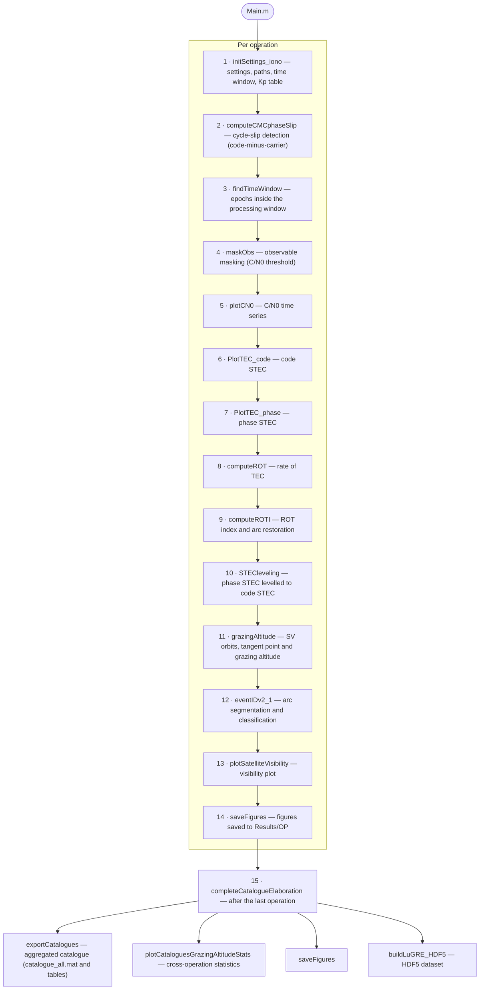
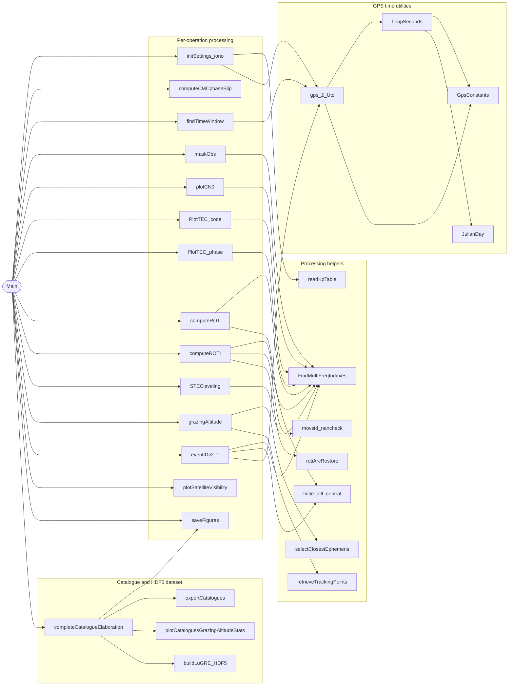
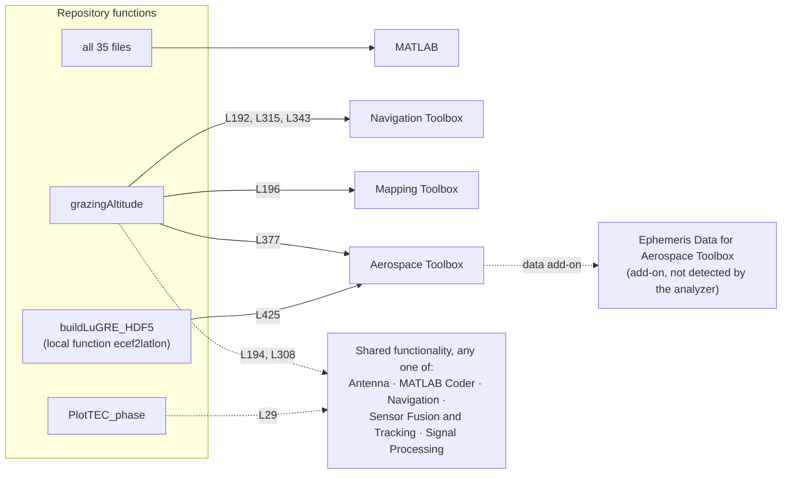

# LuGRE dispersive-arc catalogue: processing code

[](https://doi.org/10.5281/zenodo.23216092)
[](https://doi.org/10.5281/zenodo.16411687)
<!-- TODO: add the software DOI badge after the first GitHub release is archived on Zenodo -->

This repository contains the MATLAB code used to generate the catalogue

> **A GNSS radio occultation catalogue: Dispersive arcs from cislunar and lunar surface observations**<br>
> F. Fiorina, A. Minetto, R. Ghidoni, M. Guerra, C. Cesaroni, L. Spogli, A. Nardin, F. Dovis<br>
> Zenodo, 2026 — DOI: [10.5281/zenodo.23216092](https://doi.org/10.5281/zenodo.23216092)

The catalogue contains the ionospheric and plasmaspheric occultation arcs (ingress, egress, tangent) observed by the Lunar GNSS Receiver Experiment (LuGRE) during Firefly's Blue Ghost Mission 1 (BGM1), January–March 2025. The code processes 1 Hz dual-frequency GPS and Galileo observables to compute STEC, ROT and ROTI, computes the grazing (tangent-point) altitude of each raypath, segments and classifies the arcs, and writes the final HDF5 file.

This README explains how to:

1. install the required software ([Section 1](#1-requirements));
2. build the folder structure and obtain all input data ([Sections 2–3](#2-folder-structure));
3. configure the experiment, including the exact settings that reproduce the published catalogue ([Section 4](#4-configuration-initsettings_ionom));
4. run the pipeline and generate the HDF5 file ([Section 5](#5-running-the-pipeline)).

The function dependency graph and the function-to-toolbox links are given in [Appendix A](#appendix-a--function-dependency-graph) and [Appendix B](#appendix-b--matlab-toolbox-dependencies).

---

## Contents

- [1. Requirements](#1-requirements)
- [2. Folder structure](#2-folder-structure)
- [3. Input data](#3-input-data)
  - [3.1 Root folder and code](#31-root-folder-and-code)
  - [3.2 OPTABLE.csv](#32-optablecsv)
  - [3.3 Kp index table](#33-kp-index-table)
  - [3.4 Operation folders](#34-operation-folders)
  - [3.5 BROADCAST — GNSS broadcast ephemerides](#35-broadcast--gnss-broadcast-ephemerides)
  - [3.6 OBS — observables from LuNART](#36-obs--observables-from-lunart)
  - [3.7 TRUTH — BGM1 lander trajectory from SPICE](#37-truth--bgm1-lander-trajectory-from-spice)
  - [3.8 Check the Datasets folder](#38-check-the-datasets-folder)
- [4. Configuration (initSettings_iono.m)](#4-configuration-initsettings_ionom)
- [5. Running the pipeline](#5-running-the-pipeline)
- [6. Troubleshooting](#6-troubleshooting)
- [7. How to cite](#7-how-to-cite)
- [8. License](#8-license)
- [Appendix A — Function dependency graph](#appendix-a--function-dependency-graph)
- [Appendix B — MATLAB toolbox dependencies](#appendix-b--matlab-toolbox-dependencies)

---

## 1. Requirements

### 1.1 MATLAB

The code was developed in **MATLAB R2026b**. It has also been tested with **MATLAB R2022b**, and it runs there.

| Product | Required | Used for |
|---|---|---|
| MATLAB | yes | all functions |
| Navigation Toolbox | yes | reading RINEX navigation files and propagating GNSS satellite orbits (e.g. `rinexread`, `gnssconstellation`) |
| Mapping Toolbox | yes | WGS-84 geodetic height of the tangent point (`grazingAltitude.m`) |
| Aerospace Toolbox | yes | coordinate conversions and planetary ephemerides (`grazingAltitude.m`, `buildLuGRE_HDF5.m`) |
| **Ephemeris Data for Aerospace Toolbox** (add-on) | **yes** | ephemeris data required by `planetEphemeris`. Install it by running `aeroDataPackage` in the Command Window and choosing *Ephemeris Data for Aerospace Toolbox*. The Dependency Analyzer does not detect this add-on, so it does not appear in Appendix B. |

Some calls (e.g. `physconst`) are provided by several products: Antenna Toolbox, MATLAB Coder, Navigation Toolbox, Sensor Fusion and Tracking Toolbox, or Signal Processing Toolbox. Any one of them is enough. Navigation Toolbox is already required, so these calls need no extra product.

To check what is installed, run `ver` in the Command Window.

### 1.2 Tools used only to prepare the input data

| Tool | Used in | Notes |
|---|---|---|
| [LuNART](https://github.com/NavsasPolito/LuNART) (MATLAB) | [Section 3.6](#36-obs--observables-from-lunart) | Generates `obsSolutions.mat` from the public LuGRE data. Its own requirements are listed in the LuNART README: MATLAB R2023a or later is suggested, with Signal Processing Toolbox, Statistics and Machine Learning Toolbox, Aerospace Toolbox and MATLAB Report Generator. |
| [MICE, the SPICE Toolkit for MATLAB](https://naif.jpl.nasa.gov/naif/toolkit_MATLAB.html) | [Section 3.7](#37-truth--bgm1-lander-trajectory-from-spice) | Generates `spc_GroundTruth.mat` from the NAIF CLPS SPICE kernels. |
| NASA Earthdata account (free) | [Section 3.5](#35-broadcast--gnss-broadcast-ephemerides) | Needed to download the broadcast ephemerides from the CDDIS archive. |

---

## 2. Folder structure

The pipeline expects **one root folder** that contains three folders: `Useful_Code`, `Results` and `Datasets`. The root folder is the folder of this repository once it is cloned ([Section 3.1](#31-root-folder-and-code)); it can have any name and can be anywhere on a local disk. `Useful_Code` is part of the repository, while `Results` and `Datasets` are created by the user inside the same folder and are excluded from version control by `.gitignore`.

```text
<ROOT>/                                  ← this repository (select it when the HDF5 step asks for a folder)
├── README.md
├── LICENSE                              ← GPLv3 (Section 8)
├── LICENSES/                            ← license texts: GPL-3.0.txt, Apache-2.0.txt
├── .gitignore                           ← excludes Results/ and Datasets/
├── Useful_Code/
│   ├── Main.m                           ← entry point
│   └── Libraries/                       ← all functions (34 files, see Appendix A)
├── Results/                             ← empty at start; filled by the pipeline
└── Datasets/
    ├── OPTABLE.csv                      ← Section 3.2
    ├── Kp_ap_since_1932.txt             ← Section 3.3
    ├── OP1_0/                           ← one folder per operation (20 in total, Section 3.4)
    │   └── RTP/
    │       └── SupportData/
    │           ├── BROADCAST/
    │           │   └── NAV_multi/
    │           │       └── BRDC00IGS_R_20250150000_01D_MN.rnx   ← Section 3.5
    │           ├── OBS/
    │           │   └── obsSolutions.mat                         ← Section 3.6
    │           └── TRUTH/
    │               └── spc_GroundTruth.mat                      ← Section 3.7
    ├── OP2_0/
    │   └── RTP/SupportData/{BROADCAST/NAV_multi, OBS, TRUTH}
    ├── …
    └── OP78_1/
        └── RTP/SupportData/{BROADCAST/NAV_multi, OBS, TRUTH}
```

| Folder | Created by | Content |
|---|---|---|
| `Useful_Code` | cloning this repository ([Section 3.1](#31-root-folder-and-code)) | `Main.m` and the `Libraries` folder with all the functions. |
| `Results` | the user (empty folder) | All outputs. The pipeline creates one subfolder per operation (`Results/<OP>/`) and writes the aggregated catalogue `Results/catalogue_all.mat`. |
| `Datasets` | the user ([Section 3](#3-input-data)) | All input data. The code reads every input from here. |

> [!IMPORTANT]
> File and folder names are case-sensitive on Linux and must match the names above exactly. Avoid folders synchronised by cloud services (OneDrive, Dropbox, iCloud), as they can block the creation of output folders.

---

## 3. Input data

### 3.1 Root folder and code

Clone this repository. The cloned folder is the root folder `<ROOT>` and already contains `Useful_Code`:

```bash
git clone https://github.com/<owner>/cislunar_dispersive_arcs_detector_and_classifier.git
```

If you download the repository as a ZIP file instead, extract it anywhere: the extracted folder is the root folder.

Then create the empty `Results` folder and the `Datasets` skeleton inside the root folder. The following MATLAB snippet, run from the root folder, creates all of them:

```matlab
% Run from <ROOT>
ops = {'OP1_0','OP2_0','OP5_0','OP9_0','OP12_0','OP14_0','OP17_0','OP18_0', ...
       'OP21_0','OP22_0','OP23_0','OP27_0','OP37_0','OP38_0','OP40_0', ...
       'OP74_0','OP76_0','OP77_0','OP77_1','OP78_1'};
mkdir('Results');
for k = 1:numel(ops)
    sd = fullfile('Datasets', ops{k}, 'RTP', 'SupportData');
    mkdir(fullfile(sd, 'BROADCAST', 'NAV_multi'));
    mkdir(fullfile(sd, 'OBS'));
    mkdir(fullfile(sd, 'TRUTH'));
end
```

### 3.2 OPTABLE.csv

`OPTABLE.csv` is the LuGRE operations table. It is distributed with the public LuGRE mission data:

1. Download `LuGRE.zip` from the LuGRE Zenodo record: <https://doi.org/10.5281/zenodo.16411687>.
2. Extract it on a local disk. The table is at `Ancillary/OPTABLE.csv`.
3. **Apply the erratum published on the Zenodo record.** Row 13 of `OPTABLE.csv` (operation `23_0`) must be replaced by:

   ```text
   23_0,L,61.19,2025/02/14 04:01:54,RTP-SC,2025/02/14 04:04:10,2025/02/14 04:56:32,2025/02/14 04:58:53.015,L1/E1,4,8,400,,,
   ```

4. Copy the corrected file to `Datasets/OPTABLE.csv`.

Keep the extracted LuGRE folder: LuNART uses it in [Section 3.6](#36-obs--observables-from-lunart). Apply the erratum **before** running LuNART, because LuNART also reads `Ancillary/OPTABLE.csv`.

### 3.3 Kp index table

The geomagnetic activity of each arc (Kp index, NOAA G-scale) is taken from the GFZ Potsdam Kp file.

1. Download `Kp_ap_since_1932.txt` from GFZ:
   - direct link: <https://kp.gfz.de/fileadmin/files_for_gfz_cms/Kp_ap_since_1932.txt>
   - file index: <https://www-app3.gfz-potsdam.de/data.php>
2. Save it as `Datasets/Kp_ap_since_1932.txt`. Keep this exact file name, because `initSettings_iono.m` looks for it.
3. Open the file and check that its last line is **later than the end of the mission** (`settings.opts.missionEnd = 17-03-2025 00:38:17`). The file is updated daily, so any copy downloaded today satisfies this.

The file is read when the settings are created (`readKpTable` is called inside `initSettings_iono.m`), so it must be present before the first run.

### 3.4 Operation folders

The catalogue uses the **20 LuGRE operations** that produced real-time (RTP) observables:

| Mission phase (Parker et al., 2026) | Operations |
|---|---|
| Commissioning | `OP1_0`, `OP2_0` |
| Transit | `OP5_0`, `OP9_0`, `OP12_0`, `OP14_0`, `OP17_0`, `OP18_0`, `OP21_0`, `OP22_0` |
| Lunar orbit | `OP23_0`, `OP27_0`, `OP37_0` |
| Lunar surface | `OP38_0`, `OP40_0`, `OP74_0`, `OP76_0`, `OP77_0`, `OP77_1`, `OP78_1` |

- Folder names must match the IDs above exactly (`OP<n>_0` or `OP<n>_1`). The `_0`/`_1` suffix is part of the official LuGRE operation ID (Parker et al., 2026): for example, `OP77_0` and `OP77_1` are two different operations.
- **`OP3_0` is excluded** from the start, because it contains too few observables.
- Operations that recorded only I/Q samples (`OP4_1`, `OP31_0`, `OP32_0`, `OP73_0`, `OP78_0`) have no RTP observables and are not used.

Each operation folder must contain `RTP/SupportData/` with the three subfolders `BROADCAST/NAV_multi`, `OBS` and `TRUTH`, filled as described in Sections [3.5](#35-broadcast--gnss-broadcast-ephemerides)–[3.7](#37-truth--bgm1-lander-trajectory-from-spice).

### 3.5 BROADCAST — GNSS broadcast ephemerides

`BROADCAST/NAV_multi/` contains the daily multi-GNSS broadcast navigation file (RINEX 3) of the IGS for the day of the operation, for example `BRDC00IGS_R_20250150000_01D_MN.rnx` (year 2025, day of year 015).

**Where to download.** The files are distributed by the NASA CDDIS archive (an IGS Global Data Centre), which requires a free [NASA Earthdata Login](https://urs.earthdata.nasa.gov/) account:

```text
https://cddis.nasa.gov/archive/gnss/data/daily/2025/brdc/BRDC00IGS_R_2025DDD0000_01D_MN.rnx.gz
```

where `DDD` is the day of year. The 20 operations need **17 files** (some days are shared by more than one operation).

**How to download.**

1. Log in at <https://urs.earthdata.nasa.gov/> (create a free account if you do not have one).
2. Open each of the links below in a web browser. The first link redirects you to the Earthdata login page; after you log in, the download starts.

   | Day of year | Link |
   |---|---|
   | 015 | [BRDC00IGS_R_20250150000_01D_MN.rnx.gz](https://cddis.nasa.gov/archive/gnss/data/daily/2025/brdc/BRDC00IGS_R_20250150000_01D_MN.rnx.gz) |
   | 016 | [BRDC00IGS_R_20250160000_01D_MN.rnx.gz](https://cddis.nasa.gov/archive/gnss/data/daily/2025/brdc/BRDC00IGS_R_20250160000_01D_MN.rnx.gz) |
   | 019 | [BRDC00IGS_R_20250190000_01D_MN.rnx.gz](https://cddis.nasa.gov/archive/gnss/data/daily/2025/brdc/BRDC00IGS_R_20250190000_01D_MN.rnx.gz) |
   | 025 | [BRDC00IGS_R_20250250000_01D_MN.rnx.gz](https://cddis.nasa.gov/archive/gnss/data/daily/2025/brdc/BRDC00IGS_R_20250250000_01D_MN.rnx.gz) |
   | 030 | [BRDC00IGS_R_20250300000_01D_MN.rnx.gz](https://cddis.nasa.gov/archive/gnss/data/daily/2025/brdc/BRDC00IGS_R_20250300000_01D_MN.rnx.gz) |
   | 034 | [BRDC00IGS_R_20250340000_01D_MN.rnx.gz](https://cddis.nasa.gov/archive/gnss/data/daily/2025/brdc/BRDC00IGS_R_20250340000_01D_MN.rnx.gz) |
   | 036 | [BRDC00IGS_R_20250360000_01D_MN.rnx.gz](https://cddis.nasa.gov/archive/gnss/data/daily/2025/brdc/BRDC00IGS_R_20250360000_01D_MN.rnx.gz) |
   | 038 | [BRDC00IGS_R_20250380000_01D_MN.rnx.gz](https://cddis.nasa.gov/archive/gnss/data/daily/2025/brdc/BRDC00IGS_R_20250380000_01D_MN.rnx.gz) |
   | 043 | [BRDC00IGS_R_20250430000_01D_MN.rnx.gz](https://cddis.nasa.gov/archive/gnss/data/daily/2025/brdc/BRDC00IGS_R_20250430000_01D_MN.rnx.gz) |
   | 045 | [BRDC00IGS_R_20250450000_01D_MN.rnx.gz](https://cddis.nasa.gov/archive/gnss/data/daily/2025/brdc/BRDC00IGS_R_20250450000_01D_MN.rnx.gz) |
   | 050 | [BRDC00IGS_R_20250500000_01D_MN.rnx.gz](https://cddis.nasa.gov/archive/gnss/data/daily/2025/brdc/BRDC00IGS_R_20250500000_01D_MN.rnx.gz) |
   | 058 | [BRDC00IGS_R_20250580000_01D_MN.rnx.gz](https://cddis.nasa.gov/archive/gnss/data/daily/2025/brdc/BRDC00IGS_R_20250580000_01D_MN.rnx.gz) |
   | 062 | [BRDC00IGS_R_20250620000_01D_MN.rnx.gz](https://cddis.nasa.gov/archive/gnss/data/daily/2025/brdc/BRDC00IGS_R_20250620000_01D_MN.rnx.gz) |
   | 063 | [BRDC00IGS_R_20250630000_01D_MN.rnx.gz](https://cddis.nasa.gov/archive/gnss/data/daily/2025/brdc/BRDC00IGS_R_20250630000_01D_MN.rnx.gz) |
   | 073 | [BRDC00IGS_R_20250730000_01D_MN.rnx.gz](https://cddis.nasa.gov/archive/gnss/data/daily/2025/brdc/BRDC00IGS_R_20250730000_01D_MN.rnx.gz) |
   | 074 | [BRDC00IGS_R_20250740000_01D_MN.rnx.gz](https://cddis.nasa.gov/archive/gnss/data/daily/2025/brdc/BRDC00IGS_R_20250740000_01D_MN.rnx.gz) |
   | 075 | [BRDC00IGS_R_20250750000_01D_MN.rnx.gz](https://cddis.nasa.gov/archive/gnss/data/daily/2025/brdc/BRDC00IGS_R_20250750000_01D_MN.rnx.gz) |

   Alternatively, open the folder <https://cddis.nasa.gov/archive/gnss/data/daily/2025/brdc/> and search for each file name. The folder contains many other navigation files with similar names; take only the ones ending in `_01D_MN.rnx.gz`.
3. **Decompress** the downloaded files. The pipeline reads the uncompressed `.rnx` file. In MATLAB, run `gunzip` on the download folder:

   ```matlab
   gunzip('<download_folder>/BRDC00IGS_R_2025*_01D_MN.rnx.gz')
   ```

   Any other tool that handles `.gz` files (e.g. 7-Zip, or `gunzip` on macOS/Linux) works as well. If a downloaded file is only a few kB and cannot be decompressed, the browser saved the login page instead of the file: log in again and repeat the download.
4. **Copy** each `.rnx` file into the `NAV_multi` folder of its operation, as listed in the table below.

The same daily files are usually also mirrored by the other IGS Global Data Centres listed at <https://igs.org/data-access/>. The directory layout differs between centres.

**Which file goes in which operation.** Copy one file into each `NAV_multi` folder according to the table below. The RTP windows are taken from Table 8 of Parker et al. (2026); the processing window actually used is read from `obsSolutions.mat` ([Section 4.3](#43-processing-time-window)).

| Operation | RTP start (UTC) | RTP end (UTC) | Day of year 2025 | File in `NAV_multi/` |
|---|---|---|---|---|
| `OP1_0` | 2025-01-15 15:29:17 | 2025-01-15 16:16:26 | 015 | `BRDC00IGS_R_20250150000_01D_MN.rnx` |
| `OP2_0` | 2025-01-16 01:36:47 | 2025-01-16 02:23:58 | 016 | `BRDC00IGS_R_20250160000_01D_MN.rnx` |
| `OP5_0` | 2025-01-19 04:57:41 | 2025-01-19 05:49:50 | 019 | `BRDC00IGS_R_20250190000_01D_MN.rnx` |
| `OP9_0` | 2025-01-25 05:14:06 | 2025-01-25 06:06:01 | 025 | `BRDC00IGS_R_20250250000_01D_MN.rnx` |
| `OP12_0` | 2025-01-30 04:30:39 | 2025-01-30 05:22:47 | 030 | `BRDC00IGS_R_20250300000_01D_MN.rnx` |
| `OP14_0` | 2025-01-30 22:46:25 | 2025-01-30 23:38:33 | 030 | `BRDC00IGS_R_20250300000_01D_MN.rnx` |
| `OP17_0` | 2025-02-03 09:19:10 | 2025-02-03 10:11:21 | 034 | `BRDC00IGS_R_20250340000_01D_MN.rnx` |
| `OP18_0` | 2025-02-05 23:04:39 | 2025-02-05 23:56:49 | 036 | `BRDC00IGS_R_20250360000_01D_MN.rnx` |
| `OP21_0` ⁽ᵃ⁾ | 2025-02-07 23:34:39 | 2025-02-08 00:26:48 | 038 → 039 | `BRDC00IGS_R_20250380000_01D_MN.rnx` |
| `OP22_0` | 2025-02-12 02:53:12 | 2025-02-12 03:45:35 | 043 | `BRDC00IGS_R_20250430000_01D_MN.rnx` |
| `OP23_0` | 2025-02-14 04:04:10 | 2025-02-14 04:56:32 | 045 | `BRDC00IGS_R_20250450000_01D_MN.rnx` |
| `OP27_0` | 2025-02-19 15:28:18 | 2025-02-19 16:20:27 | 050 | `BRDC00IGS_R_20250500000_01D_MN.rnx` |
| `OP37_0` | 2025-02-27 16:15:46 | 2025-02-27 17:07:14 | 058 | `BRDC00IGS_R_20250580000_01D_MN.rnx` |
| `OP38_0` ⁽ᵃ⁾ | 2025-03-03 06:19:09 | 2025-03-04 06:10:41 | 062 → 063 | `BRDC00IGS_R_20250620000_01D_MN.rnx` |
| `OP40_0` | 2025-03-04 07:09:59 | 2025-03-04 20:31:50 | 063 | `BRDC00IGS_R_20250630000_01D_MN.rnx` |
| `OP74_0` ⁽ᵃ⁾ | 2025-03-14 12:54:22 | 2025-03-15 12:44:57 | 073 → 074 | `BRDC00IGS_R_20250730000_01D_MN.rnx` |
| `OP76_0` ⁽ᵃ⁾ | 2025-03-15 13:21:42 | 2025-03-16 15:05:09 | 074 → 075 | `BRDC00IGS_R_20250740000_01D_MN.rnx` |
| `OP77_0` | 2025-03-16 15:17:53 | 2025-03-16 17:55:09 | 075 | `BRDC00IGS_R_20250750000_01D_MN.rnx` |
| `OP77_1` | 2025-03-16 19:20:26 | 2025-03-16 21:58:55 | 075 | `BRDC00IGS_R_20250750000_01D_MN.rnx` |
| `OP78_1` | 2025-03-16 22:16:51 | 2025-03-16 22:50:32 | 075 | `BRDC00IGS_R_20250750000_01D_MN.rnx` |

⁽ᵃ⁾ The RTP window crosses 00:00 UTC. The pipeline reads one navigation file per operation, which is the file of the start day.

> [!WARNING]
> Each `NAV_multi` folder must contain **exactly one `.rnx` file**. If it contains none, or more than one, `initSettings_iono.m` stops with the error `initSettings:rnxFile`. Other files (for example the original `.gz` archive) are ignored, but it is cleaner to remove them.

### 3.6 OBS — observables from LuNART

`OBS/obsSolutions.mat` contains the GNSS observables of the operation. It is generated from the public LuGRE data with LuNART, the LuGRE analysis tool developed by the NavSAS group.

1. **Download LuNART.** Go to <https://github.com/NavsasPolito/LuNART>, click *Code → Download ZIP* and extract it. This gives the folder `LuNART-main`.
2. **Download the LuGRE data** (if not already done in [Section 3.2](#32-optablecsv)) from <https://doi.org/10.5281/zenodo.16411687>, extract it on a local disk (not an external drive), and apply the `OPTABLE.csv` erratum. Do not rename any file or folder of the LuGRE data.
3. **Start LuNART.** In MATLAB, set the current folder to `LuNART-main` and run:

   ```matlab
   AnalysisTool
   ```

4. **Set the input and output folders** as explained in the LuNART README (section *0. LuNART Setup*): the input folder is the root of the extracted LuGRE data folder, and the output folder is any existing folder where you have write permission. The status lamps turn green when the folders are valid.
5. In the *Load Operation Window* panel, select the operation in the **Select Operation Window** drop-down list and press **Load Data**. Wait until the progress bar finishes and the lamps confirm that the data were parsed.
6. Open the folder `LuNART-main/data/`. It now contains a folder for the operation just processed. Inside it you find `obsSolutions.mat`.
7. Copy `obsSolutions.mat` to `Datasets/<OP>/RTP/SupportData/OBS/OP<n>_#/obsSolutions.mat`.
8. Repeat steps 5–7 for all 20 operations of [Section 3.4](#34-operation-folders). Do not process `OP3_0`.

`obsSolutions.mat` contains the struct array `obsSolutions`, with one element per satellite and signal (fields such as `SV`, `channel`, `PRN`, `rxTime`, `weekNumber`, `GPStime`, `Doppler`, `DopplerRate`, `CarrierPhase`, `rawP`, `cn0`). All elements share the same 1 Hz epoch grid (`weekNumber`, `GPStime`).

### 3.7 TRUTH — BGM1 lander trajectory from SPICE

`TRUTH/spc_GroundTruth.mat` contains the position of the BGM1 lander (and therefore of the LuGRE receiver) in the Earth-centred, Earth-fixed frame, **at the exact epochs of `obsSolutions.mat`**. It is computed from the SPICE kernels of the NASA CLPS programme, archived by NAIF:

- Archive: <https://naif.jpl.nasa.gov/pub/naif/pds/pds4/clps/clps_spice/>
- Archive description: `document/spiceds_v004.html` (latest version at the time of writing)

In the archive, Blue Ghost Mission 1 is CLPS task order **TO19D**, the lander NAIF ID is **−2711**, and the whole-mission meta-kernel is `spice_kernels/mk/clps_to19d_v001.tm`.

**File content expected by the pipeline:**

| Variable | Field | Size | Unit | Description |
|---|---|---|---|---|
| `GroundTruth` | `pos_ecef` | N × 3 | m | Lander position in ECEF (ITRF93), one row per epoch of `obsSolutions(1).GPStime` |
| `GroundTruth` | `vel_ecef` | N × 3 | m/s | Lander velocity in ECEF (ITRF93) |
| `GroundTruth` | `weekNumber`, `GPStime` | N × 1 | week, s | GPS epochs, copied from `obsSolutions(1)` for traceability |

Row *i* of `pos_ecef` must correspond to epoch *i* of `obsSolutions(1).GPStime`.

#### Step 1 — Install MICE

Download the MICE package for your platform from <https://naif.jpl.nasa.gov/naif/toolkit_MATLAB.html>, extract it, and add it to the MATLAB path:

```matlab
addpath('<path_to>/mice/src/mice');
addpath('<path_to>/mice/lib');
```

On Apple-silicon Macs, the Intel MICE package runs only with the Intel (Rosetta) build of MATLAB. Alternatively, the same computation can be done in Python with [SpiceyPy](https://github.com/AndrewAnnex/SpiceyPy), using the same kernels and time conversion, and saved with `scipy.io.savemat`.

#### Step 2 — Download the BGM1 kernels

The meta-kernel `clps_to19d_v001.tm` lists 26 kernels (about 175 MB in total). The script below mirrors them, together with the meta-kernel, into a local folder that keeps the archive layout (`spice_kernels/<type>/<file>`):

```matlab
% downloadBGM1kernels.m — run from the folder where you want to keep the kernels
base  = 'https://naif.jpl.nasa.gov/pub/naif/pds/pds4/clps/clps_spice/spice_kernels/';
kdir  = fullfile(pwd, 'clps_spice', 'spice_kernels');
files = { ...
  'mk/clps_to19d_v001.tm', ...
  'lsk/naif0012.tls', ...
  'pck/pck00011.tpc', 'pck/earth_2025_250826_2125_predict.bpc', ...
  'pck/earth_000101_260530_260303.bpc', 'pck/moon_pa_de440_200625.bpc', ...
  'fk/moon_de440_250416.tf', 'fk/earth_topo_201023.tf', ...
  'fk/earth_assoc_itrf93.tf', 'fk/moon_assoc_me.tf', 'fk/clps_to19d_bgm1_v01.tf', ...
  'ik/clps_to19d_bgm1_lexi_v01.ti', 'sclk/clps_to19d_bgm1_v01.tsc', ...
  'spk/de440s.bsp', 'spk/earthstns_itrf93_201023.bsp', ...
  'spk/clps_to19d_bgm1_struct_v01.bsp', 'spk/clps_to19d_bgm1_ls_250302_v01.bsp', ...
  'spk/clps_to19d_bgm1_atls_250302_v01.bsp', ...
  'spk/clps_to19d_bgm1_cru_rec_250115_250302_v01.bsp', ...
  'spk/clps_to19d_bgm1_cru_pre_250302_v01.bsp', ...
  'spk/clps_to19d_bgm1_edl_rec_250302_v01.bsp', ...
  'ck/clps_to19d_bgm1_cru_rec_250115_250310_v01.bc', ...
  'ck/clps_to19d_bgm1_edl_rec_250302_v01.bc', 'ck/clps_to19d_bgm1_surf_ops_v01.bc', ...
  'ck/clps_to19d_bgm1_hga_stowed_v01.bc', 'ck/clps_to19d_bgm1_hga_mea_v01.bc', ...
  'ck/clps_to19d_bgm1_lexi_stowed_v01.bc', 'ck/clps_to19d_bgm1_lexi_mea_v01.bc'};
opt = weboptions('Timeout', 120);
for k = 1:numel(files)
    out = fullfile(kdir, files{k});
    if ~isfolder(fileparts(out)), mkdir(fileparts(out)); end
    if ~isfile(out)
        fprintf('Downloading %s\n', files{k});
        websave(out, [base files{k}], opt);
    end
end
```

If NAIF publishes a newer meta-kernel (`clps_to19d_v002.tm`, …), open it and download the kernels it lists instead. Kernel integrity can be checked against the MD5 list in `miscellaneous/checksum/` of the archive.

#### Step 3 — Compute `spc_GroundTruth.mat` for every operation

The meta-kernel uses `PATH_VALUES = ( '..' )`, which SPICE resolves relative to the current folder. The script therefore loads the meta-kernel from inside the `mk` folder, so the file does not need to be edited.

Time conversion: `obsSolutions` epochs are GPS week and time of week. GPS time runs at the same rate as Terrestrial Time (TT, called TDT in SPICE), with the GPS epoch 1980-01-06 00:00:00 GPST = 00:00:19 TAI = 00:00:51.184 TT. Each epoch is converted to TT and then to ephemeris time (TDB) with `cspice_unitim`.

```matlab
% makeGroundTruth.m — builds TRUTH/spc_GroundTruth.mat for every operation
root = '<ROOT>';                                   % folder with Useful_Code, Datasets, Results
kdir = '<path_to>/clps_spice/spice_kernels';       % local kernel mirror (Step 2)
ops  = {'OP1_0','OP2_0','OP5_0','OP9_0','OP12_0','OP14_0','OP17_0','OP18_0', ...
        'OP21_0','OP22_0','OP23_0','OP27_0','OP37_0','OP38_0','OP40_0', ...
        'OP74_0','OP76_0','OP77_0','OP77_1','OP78_1'};

% Load all BGM1 kernels through the meta-kernel
here = cd(fullfile(kdir, 'mk'));
cspice_furnsh('clps_to19d_v001.tm');
cd(here);

% GPS epoch expressed as TT (TDT) seconds past J2000
tt0 = cspice_unitim(cspice_str2et('1980 JAN 06 00:00:51.184 TDT'), 'TDB', 'TDT');

for k = 1:numel(ops)
    sd  = fullfile(root, 'Datasets', ops{k}, 'RTP', 'SupportData');
    S   = load(fullfile(sd, 'OBS', 'obsSolutions.mat'));
    wn  = double(S.obsSolutions(1).weekNumber(:));
    tow = double(S.obsSolutions(1).GPStime(:));
    gps = wn*604800 + tow;                                   % seconds since the GPS epoch
    ok  = isfinite(gps);

    et = cspice_unitim(tt0 + gps(ok).', 'TDT', 'TDB');       % ephemeris time (TDB), 1 x N
    st = cspice_spkezr('-2711', et, 'ITRF93', 'NONE', 'EARTH');  % 6 x N state [km, km/s]

    GroundTruth            = struct();
    GroundTruth.weekNumber = wn;
    GroundTruth.GPStime    = tow;
    GroundTruth.pos_ecef   = nan(numel(gps), 3);
    GroundTruth.vel_ecef   = nan(numel(gps), 3);
    GroundTruth.pos_ecef(ok,:) = 1e3 * st(1:3,:).';          % [m]
    GroundTruth.vel_ecef(ok,:) = 1e3 * st(4:6,:).';          % [m/s]

    save(fullfile(sd, 'TRUTH', 'spc_GroundTruth.mat'), 'GroundTruth');
    fprintf('%-7s %6d epochs  |r| = %.2f Earth radii\n', ops{k}, nnz(ok), ...
            norm(GroundTruth.pos_ecef(find(ok,1),:)) / 6378137);
end
cspice_kclear;
```

Notes:

- `'NONE'` returns the geometric position of the lander at each epoch, with no light-time or aberration correction. `ITRF93` is the high-accuracy Earth-fixed frame of SPICE.
- The script handles both mission phases. During transit and lunar orbit the position comes from the cruise and EDL SPK files. On the surface (`OP38_0` onwards) it comes from the landing-site and landing-site-to-lander SPK files. SPICE chains them automatically.
- **Sanity check:** the printed distance minus 1 should be close to the altitude in Earth radii reported for each operation in Table 8 of Parker et al. (2026) (e.g. about 56 for `OP40_0`).
- If an epoch is not covered by the kernels, `cspice_spkezr` stops with `SPICE(SPKINSUFFDATA)`. Coverage can be inspected with the `brief` utility distributed with the toolkit (e.g. `brief -c clps_to19d_bgm1_cru_rec_250115_250302_v01.bsp`).

### 3.8 Check the Datasets folder

Before running the pipeline, run this check from the root folder. Every row must show `1`.

```matlab
ops = {'OP1_0','OP2_0','OP5_0','OP9_0','OP12_0','OP14_0','OP17_0','OP18_0', ...
       'OP21_0','OP22_0','OP23_0','OP27_0','OP37_0','OP38_0','OP40_0', ...
       'OP74_0','OP76_0','OP77_0','OP77_1','OP78_1'};
ds = fullfile(pwd, 'Datasets');
fprintf('OPTABLE.csv           %d\n', isfile(fullfile(ds, 'OPTABLE.csv')));
fprintf('Kp_ap_since_1932.txt  %d\n', isfile(fullfile(ds, 'Kp_ap_since_1932.txt')));
fprintf('%-8s %4s %4s %6s\n', 'OP', 'OBS', 'NAV', 'TRUTH');
for k = 1:numel(ops)
    sd  = fullfile(ds, ops{k}, 'RTP', 'SupportData');
    nav = numel(dir(fullfile(sd, 'BROADCAST', 'NAV_multi', '*.rnx'))) == 1;
    obs = isfile(fullfile(sd, 'OBS', 'obsSolutions.mat'));
    gt  = isfile(fullfile(sd, 'TRUTH', 'spc_GroundTruth.mat'));
    fprintf('%-8s %4d %4d %6d\n', ops{k}, obs, nav, gt);
end
```

---

## 4. Configuration (`initSettings_iono.m`)

All user parameters are set in `Useful_Code/Libraries/initSettings_iono.m`, which returns the `settings` structure used by every function. `Main.m` calls it once per operation as `settings = initSettings_iono(jj)`, where `jj` is the index of the operation in the `OPs` list.

> [!IMPORTANT]
> **To reproduce the catalogue published under DOI [10.5281/zenodo.23216092](https://doi.org/10.5281/zenodo.23216092), use `initSettings_iono.m` exactly as distributed in this repository.** The values are listed in [Section 4.8](#48-settings-used-for-the-published-catalogue). With the folder structure of [Section 2](#2-folder-structure), the paths are set automatically ([Section 4.2](#42-paths)), so nothing needs to be edited.

### 4.1 Operations

| Parameter | Description |
|---|---|
| `OPs` | Cell array with the IDs of the operations to process. They must match the folder names in `Datasets` ([Section 3.4](#34-operation-folders)). |
| `settings.OP` | ID of the operation processed in the current call, `OPs(jj)`. |

### 4.2 Paths

| Parameter | Value | Description |
|---|---|---|
| `settings.rootPath` | root folder | Folder that contains `Useful_Code`, `Datasets` and `Results`, set it by hand. |
| `settings.datasetsPath` | `<ROOT>/Datasets` | Input data root. |
| `settings.inputPath` | `<ROOT>/Datasets/<OP>/RTP/SupportData` | Inputs of the current operation. |
| `settings.opTablePath` | `<ROOT>/Datasets/OPTABLE.csv` | Operations table. |
| `settings.kpTablePath` | `<ROOT>/Datasets/Kp_ap_since_1932.txt` | Kp index table. |
| `settings.obsPath` | `<inputPath>/OBS/obsSolutions.mat` | Observables. |
| `settings.rnxPath` | `<inputPath>/BROADCAST/NAV_multi/<file>.rnx` | Broadcast navigation file (the only file in the folder). |
| `settings.gtPath` | `<inputPath>/TRUTH/spc_GroundTruth.mat` | Lander ground truth. |
| `settings.resultPath` | `<ROOT>/Results` | Output root. |
| `settings.outputPath` | `<ROOT>/Results/<OP>` | Outputs of the current operation. Created automatically if missing. |

### 4.3 Processing time window

| Parameter | Description |
|---|---|
| `settings.window` | `'auto'`: the window spans the first and last epoch of `obsSolutions.mat` (converted from GPS time to UTC). `'manual'`: the window is set by the four parameters below. |
| `settings.epochDate_start`, `settings.epochDate_end` | `[day, month]` of the start and end of the window (manual mode only). |
| `settings.tStart_UTC`, `settings.tEnd_UTC` | `[hour, minute]` UTC of the start and end of the window (manual mode only). |

### 4.4 Constellations and signal quality

| Parameter | Description |
|---|---|
| `settings.G`, `settings.E` | `1` enables GPS and Galileo processing respectively; `0` disables it. |
| `settings.CN0_threshold` | Minimum C/N₀ (dB-Hz) for an observation to be used. |

### 4.5 STEC, ROT and ROTI

| Parameter | Description |
|---|---|
| `settings.t_gap` | Maximum observation gap (s) before the leveling filter is re-initialised. |
| `settings.ROTI_window` | `'fixed'`: ROTI is computed over a window of fixed length `settings.window_length`. (`'variable'` is reserved for a future development.) |
| `settings.window_length` | Length (s) of the ROTI window. |
| `settings.tol_window` | Tolerance on missing samples inside the ROTI window (fraction of the window). |
| `settings.arcRestore` | If `true`, gaps inside ROTI arcs are filled with interpolated values (restored ROTI). |

### 4.6 Arc segmentation and classification (`eventIDv2_1`)

| Parameter | Description |
|---|---|
| `settings.restoredROTIclass` | If `true`, the classification runs on the restored ROTI. This risks classifying interpolation artefacts, so it is `false` for the catalogue. |
| `settings.MAX_TANGENT_GAP_S` | Maximum gap (s) between two segments for them to be considered part of the same tangent arc (1 Hz sampling: gap in samples = gap in seconds). |
| `settings.OCC_GAP_S` | Minimum gap (s) between two arcs for them to be flagged as an ingress/egress occultation pair. |
| `settings.MIN_DURATION` | Minimum arc duration (s) for the arc to be classified. |
| `settings.PEAK_EDGE_TOL` | Fraction of the arc length that defines the edge-tolerance zone for peak detection (0.05 → about 3 s for a 60 s arc). |
| `settings.MEDIAN_THRESHOLD` | Threshold on \|median ROT\| (TECU/s): above it the arc is ingress or egress, below it the arc is tangent. |
| `settings.DEEP_TANGENT_HEIGHT` | Grazing-altitude threshold that defines a deep tangent arc, i.e. an arc that reaches close enough to the F2 peak. Expressed in the units of the grazing altitude (m). |

### 4.7 Plots and HDF5 options

| Parameter | Description |
|---|---|
| `settings.PlotCN0`, `PlotSTECphase`, `PlotSTECcode`, `PlotSTECleveled`, `PlotROT`, `PlotROTI`, `PlotROTI_restored`, `PlotVisibility`, `PlotGrazingAltitude`, `PlotGrazingAltitudeArcs`, `PlotGrazingAltitudeDistribution` | Enable (`true`) or disable (`false`) each figure. Figures are saved in `Results/<OP>/`. |
| `settings.opts.cataloguePath` | Aggregated catalogue used to build the HDF5 file. |
| `settings.opts.missionStart`, `settings.opts.missionEnd` | Mission time span written in the HDF5 header (`dd-MM-yyyy-HH:mm:ss`, UTC). |
| `settings.opts.DOI` | DOI written in the HDF5 header. |
| `settings.opts.localTimeMode` | `'solar'`: local solar time, LT = UTC + longitude/15 h (default, no external dependency). `'civil'` would need a latitude/longitude-to-time-zone helper that MATLAB does not provide. |
| `settings.opts.grazUnits` | Units label of the grazing altitude. |
| `settings.opts.kpTable` | Kp table read from `settings.kpTablePath` with `readKpTable`. |
| `settings.opts.idCounterScope` | Scope of the arc counter in the arc ID: `'global'` (whole mission) or `'perOP'` (per operation). |

Parameter blocks that are commented out in `initSettings_iono.m` (main-lobe/side-lobe thresholds, S4c, σφ and bending-angle parameters, and `PlotS4c`) are reserved for future developments. They are not used to build the catalogue and must stay commented out.

### 4.8 Settings used for the published catalogue

These are the values in `initSettings_iono.m` that generated the catalogue with DOI [10.5281/zenodo.23216092](https://doi.org/10.5281/zenodo.23216092).

| Group | Parameter | Value | Unit |
|---|---|---|---|
| Operations | `OPs` | the 20 operations of [Section 3.4](#34-operation-folders) | — |
| Time window | `settings.window` | `'auto'` | — |
| Constellations | `settings.G` | `1` (GPS on) | — |
| | `settings.E` | `1` (Galileo on) | — |
| Signal quality | `settings.CN0_threshold` | `20` | dB-Hz |
| ROTI restoration | `settings.arcRestore` | `true` | — |
| Leveling | `settings.t_gap` | `10` | s |
| ROTI | `settings.ROTI_window` | `'fixed'` | — |
| | `settings.window_length` | `30` (`10*3`) | s |
| | `settings.tol_window` | `0.1` | fraction |
| Classification | `settings.restoredROTIclass` | `false` | — |
| | `settings.MAX_TANGENT_GAP_S` | `300` (`5*60`) | s |
| | `settings.OCC_GAP_S` | `1800` (`30*60`) | s |
| | `settings.MIN_DURATION` | `100` | s |
| | `settings.PEAK_EDGE_TOL` | `0.05` | fraction of arc length |
| | `settings.MEDIAN_THRESHOLD` | `0.007` | TECU/s |
| | `settings.DEEP_TANGENT_HEIGHT` | `6e5` (600 km) | m |
| Plots | all `settings.Plot*` switches | `true` | — |
| HDF5 | `settings.opts.cataloguePath` | `<ROOT>/Results/catalogue_all.mat` | — |
| | `settings.opts.missionStart` | `'15-01-2025-06:11:24'` | UTC |
| | `settings.opts.missionEnd` | `'17-03-2025-00:38:17'` | UTC |
| | `settings.opts.DOI` | `'10.5281/zenodo.23216092'` | — |
| | `settings.opts.localTimeMode` | `'solar'` | — |
| | `settings.opts.grazUnits` | `'m'` | — |
| | `settings.opts.kpTable` | `readKpTable(settings.kpTablePath)` | — |
| | `settings.opts.idCounterScope` | `'global'` | — |
| Not used | main-lobe/side-lobe, S4c, σφ, bending angle | commented out | — |

To reproduce the catalogue, keep all plot switches set to `true`, as in the distributed file. Some catalogue fields (for example the tracking windows computed by `retrieveTrackingPoints`) are produced inside the plotting blocks.

---

## 5. Running the pipeline

### 5.1 Start

In MATLAB:

```matlab
cd('<ROOT>/Useful_Code')
addpath(genpath(pwd))      % adds Libraries/ to the path
Main
```

### 5.2 Processing flow

`Main.m` processes the 20 operations one after the other. For each operation it calls the functions below, in this order. After the last operation it builds the aggregated catalogue and the HDF5 file.



### 5.3 HDF5 generation

At the end of the run, `buildLuGRE_HDF5` writes the HDF5 file. **When MATLAB asks you to select a folder for the HDF5 step, select the root folder** (`<ROOT>`, the folder that contains `Useful_Code`, `Results` and `Datasets`). The builder reads the aggregated catalogue from `Results`, the time series from the per-operation results, and the receiver positions from `Datasets/<OP>/RTP/SupportData/TRUTH/spc_GroundTruth.mat`.

### 5.4 Outputs

| Location | Content |
|---|---|
| `Results/<OP>/` | Figures and per-operation products of each operation. |
| `Results/catalogue_all.mat` | Aggregated arc catalogue of all operations. |
| HDF5 file (`LuGRE_dispersive_arcs.h5`) | Final dataset, with the same structure as the file published on Zenodo. |

### 5.5 Checking the result against the published catalogue

The published catalogue contains **263 arcs**. A regenerated HDF5 file is not expected to be byte-identical to the published one (HDF5 files store, for example, creation times), so compare the content instead: number of arcs, number of arcs per class in the file header, and the values of individual arcs. For a quick look:

```matlab
h5disp('LuGRE_dispersive_arcs.h5', '/', 'min')
```

---

## 6. Troubleshooting

| Symptom | Cause and fix |
|---|---|
| `Expected exactly one .rnx file in …` (`initSettings:rnxFile`) | `NAV_multi` contains no `.rnx` file (e.g. still compressed as `.rnx.gz`) or more than one. Keep exactly one decompressed `.rnx` file ([Section 3.5](#35-broadcast--gnss-broadcast-ephemerides)). |
| `Impossible creating …` (`initSettings:mkdirFailed`) | No write permission in `Results`, or the folder is synchronised by a cloud service. Use a local folder, or pause the synchronisation. |
| Error while reading the Kp table, or Kp missing for the last arcs | `Datasets/Kp_ap_since_1932.txt` is missing, has a different name, or ends before 17-03-2025 ([Section 3.3](#33-kp-index-table)). |
| `SPICE(SPKINSUFFDATA)` in `makeGroundTruth.m` | An epoch is not covered by the loaded kernels. Check that all kernels of the meta-kernel were downloaded and inspect the coverage with `brief` ([Section 3.7](#37-truth--bgm1-lander-trajectory-from-spice)). |
| `Undefined function 'planetEphemeris'` or missing ephemeris data | Aerospace Toolbox or its *Ephemeris Data* add-on is missing. Run `aeroDataPackage` ([Section 1.1](#11-matlab)). |
| LuNART lamps stay red | Read/write permissions of the selected folders. See the LuNART README (*0. LuNART Setup*). |
| Paths too long on Windows | Keep the root folder short, for example `C:\LuGRE`. |

---

## 7. How to cite

If you use this code, please cite the code and the dataset it produced:

- **Code:** *[software citation and DOI — to be added after the Zenodo archive of the GitHub release]*
- **Catalogue:** Fiorina, F., Minetto, A., Ghidoni, R., Guerra, M., Cesaroni, C., Spogli, L., Nardin, A., & Dovis, F. (2026). *A GNSS radio occultation catalogue: Dispersive arcs from cislunar and lunar surface observations* (v1) [Data set]. Zenodo. <https://doi.org/10.5281/zenodo.23216092>
- **Article:** *[Scientific Data article — to be added after publication]*

Input data and tools used by the pipeline:

- LuGRE mission data: Parker, J. J. K., Dovis, F., et al. (2025). *Lunar GNSS Receiver Experiment (LuGRE) Mission Data* (v1). Zenodo. <https://doi.org/10.5281/zenodo.16411687>
- LuGRE first results and operations catalogue: Parker, J. J. K., et al. (2026). GNSS Reception at the Moon: First Results of the Lunar GNSS Receiver Experiment (LuGRE). *NAVIGATION*, 73(1). <https://doi.org/10.33012/navi.756>
- LuNART: NavSAS Group, Politecnico di Torino. <https://github.com/NavsasPolito/LuNART>
- Kp index: Matzka, J., Bronkalla, O., Tornow, K., Elger, K., & Stolle, C. (2021). *Geomagnetic Kp index*. GFZ Data Services. <https://doi.org/10.5880/Kp.0001>
- GNSS broadcast ephemerides: International GNSS Service (IGS), distributed by NASA CDDIS.
- SPICE: Acton, C. H. (1996). Ancillary data services of NASA's Navigation and Ancillary Information Facility. *Planetary and Space Science*, 44(1), 65–70. CLPS SPICE kernels archived by the NAIF Node of the NASA Planetary Data System.

---

## 8. License

Copyright 2026 NavSAS Group, Politecnico di Torino.

All modifications and newly written code by Francesco Fiorina are licensed under the GNU General Public License, version 3 (GPLv3); see [`LICENSE`](LICENSE).

This project includes third-party components:

- **Google GPS Measurement Tools** ([gps-measurement-tools](https://github.com/google/gps-measurement-tools)), Copyright 2016 Google Inc., licensed under the Apache License, Version 2.0. The Apache License 2.0 is compatible with GPLv3, so these files are redistributed here as part of a GPLv3 work. Their original copyright and license headers are retained.

  | File | Original file |
  |---|---|
  | `Useful_Code/Libraries/GpsConstants.m` | `opensource/GpsConstants.m` |
  | `Useful_Code/Libraries/LeapSeconds.m` | `opensource/LeapSeconds.m` |
  | `Useful_Code/Libraries/JulianDay.m` | `opensource/JulianDay.m` |
  | `Useful_Code/Libraries/gps_2_Utc.m` | `opensource/Gps2Utc.m` (renamed) |

- **LuNART** ([NavsasPolito/LuNART](https://github.com/NavsasPolito/LuNART)), Copyright 2025 NavSAS Group, licensed under GPLv3. `Useful_Code/Libraries/PlotTEC_code.m` and `Useful_Code/Libraries/PlotTEC_phase.m` are derived from LuNART (original author: Simone Zocca).

See all license texts in [`LICENSES/`](LICENSES) for details.

**Author:** Francesco Fiorina, NavSAS Group, Department of Electronics and Telecommunications (DET), Politecnico di Torino, in collaboration with INGV. Contact details are given in the associated article and in the Zenodo record.

---

## Appendix A — Function dependency graph

The dependencies were extracted with the MATLAB Dependency Analyzer (report generated on 08-Oct-2026: 35 files, 132 dependencies). `Main.m` is in `Useful_Code/`; all other files are in `Useful_Code/Libraries/`.

### A.1 Call graph

Each arrow means "calls". For readability, the five plot helpers (`action1`, `cleanLegend`, `customDataTip`, `PRNColors`, `getTicks`) are left out of the graph and listed in Table A.1.



**Table A.1 — Use of the plot helpers**

| Caller | `action1` | `cleanLegend` | `customDataTip` | `PRNColors` | `getTicks` |
|---|---|---|---|---|---|
| `plotCN0` | ✓ |  | ✓ | ✓ | ✓ |
| `PlotTEC_code` | ✓ |  | ✓ | ✓ | ✓ |
| `PlotTEC_phase` | ✓ |  | ✓ | ✓ | ✓ |
| `computeROT` | ✓ | ✓ | ✓ | ✓ | ✓ |
| `computeROTI` | ✓ | ✓ | ✓ | ✓ | ✓ |
| `STECleveling` | ✓ |  | ✓ | ✓ | ✓ |
| `grazingAltitude` | ✓ | ✓ | ✓ | ✓ |  |
| `eventIDv2_1` |  | ✓ |  |  |  |
| `cleanLegend` | ✓ |  |  |  |  |

### A.2 File inventory

**Table A.2 — All files, with callers and callees**

| File | Called by | Calls (repository functions) |
|---|---|---|
| `Main.m` | — | `initSettings_iono`, `computeCMCphaseSlip`, `findTimeWindow`, `maskObs`, `plotCN0`, `PlotTEC_code`, `PlotTEC_phase`, `computeROT`, `computeROTI`, `STECleveling`, `grazingAltitude`, `eventIDv2_1`, `plotSatelliteVisibility`, `saveFigures`, `completeCatalogueElaboration` |
| `initSettings_iono.m` | `Main` | `readKpTable`, `gps_2_Utc` |
| `computeCMCphaseSlip.m` | `Main` | — |
| `findTimeWindow.m` | `Main` | `gps_2_Utc` |
| `maskObs.m` | `Main` | `FindMultiFreqIndexes` |
| `plotCN0.m` | `Main` | `FindMultiFreqIndexes`, `action1`, `customDataTip`, `PRNColors`, `getTicks` |
| `PlotTEC_code.m` | `Main` | `FindMultiFreqIndexes`, `action1`, `customDataTip`, `PRNColors`, `getTicks` |
| `PlotTEC_phase.m` | `Main` | `FindMultiFreqIndexes`, `action1`, `customDataTip`, `PRNColors`, `getTicks` |
| `computeROT.m` | `Main` | `FindMultiFreqIndexes`, `finite_diff_central`, `action1`, `cleanLegend`, `customDataTip`, `PRNColors`, `getTicks` |
| `computeROTI.m` | `Main` | `FindMultiFreqIndexes`, `movstd_nancheck`, `rotiArcRestore`, `action1`, `cleanLegend`, `customDataTip`, `PRNColors`, `getTicks` |
| `STECleveling.m` | `Main` | `FindMultiFreqIndexes`, `action1`, `customDataTip`, `PRNColors`, `getTicks` |
| `grazingAltitude.m` | `Main` | `selectClosestEphemeris`, `retrieveTrackingPoints`, `action1`, `cleanLegend`, `customDataTip`, `PRNColors` |
| `eventIDv2_1.m` | `Main` | `FindMultiFreqIndexes`, `finite_diff_central`, `gps_2_Utc`, `cleanLegend` |
| `plotSatelliteVisibility.m` | `Main` | — |
| `saveFigures.m` | `Main`, `completeCatalogueElaboration` | — |
| `completeCatalogueElaboration.m` | `Main` | `saveFigures`, `exportCatalogues`, `plotCataloguesGrazingAltitudeStats`, `buildLuGRE_HDF5` |
| `exportCatalogues.m` | `completeCatalogueElaboration` | — |
| `plotCataloguesGrazingAltitudeStats.m` | `completeCatalogueElaboration` | — |
| `buildLuGRE_HDF5.m` | `completeCatalogueElaboration` | — |
| `FindMultiFreqIndexes.m` | `maskObs`, `plotCN0`, `PlotTEC_code`, `PlotTEC_phase`, `computeROT`, `computeROTI`, `STECleveling`, `eventIDv2_1` | — |
| `finite_diff_central.m` | `computeROT`, `eventIDv2_1` | — |
| `movstd_nancheck.m` | `computeROTI` | — |
| `rotiArcRestore.m` | `computeROTI` | — |
| `selectClosestEphemeris.m` | `grazingAltitude` | — |
| `retrieveTrackingPoints.m` | `grazingAltitude` | — |
| `readKpTable.m` | `initSettings_iono` | — |
| `gps_2_Utc.m` | `initSettings_iono`, `findTimeWindow`, `eventIDv2_1` | `LeapSeconds`, `GpsConstants` |
| `LeapSeconds.m` | `gps_2_Utc` | `GpsConstants`, `JulianDay` |
| `GpsConstants.m` | `gps_2_Utc`, `LeapSeconds` | — |
| `JulianDay.m` | `LeapSeconds` | — |
| `action1.m` | `plotCN0`, `PlotTEC_code`, `PlotTEC_phase`, `computeROT`, `computeROTI`, `STECleveling`, `grazingAltitude`, `cleanLegend` | — |
| `cleanLegend.m` | `computeROT`, `computeROTI`, `grazingAltitude`, `eventIDv2_1` | `action1` |
| `customDataTip.m` | `plotCN0`, `PlotTEC_code`, `PlotTEC_phase`, `computeROT`, `computeROTI`, `STECleveling`, `grazingAltitude` | — |
| `PRNColors.m` | `plotCN0`, `PlotTEC_code`, `PlotTEC_phase`, `computeROT`, `computeROTI`, `STECleveling`, `grazingAltitude` | — |
| `getTicks.m` | `plotCN0`, `PlotTEC_code`, `PlotTEC_phase`, `computeROT`, `computeROTI`, `STECleveling` | — |

---

## Appendix B — MATLAB toolbox dependencies

All 35 files require MATLAB. Only three files call functions from other products. Line numbers refer to the version of the code analysed on 08-Oct-2026.



**Table B.1 — Function-to-product links**

| File | Line | Product | Dependency type |
|---|---|---|---|
| `grazingAltitude.m` | 192 | Navigation Toolbox | function call |
| `grazingAltitude.m` | 194 | shared: Antenna Toolbox, MATLAB Coder, Navigation Toolbox, Sensor Fusion and Tracking Toolbox, Signal Processing Toolbox | function call |
| `grazingAltitude.m` | 196 | Mapping Toolbox | function call |
| `grazingAltitude.m` | 308 | shared: Antenna Toolbox, MATLAB Coder, Navigation Toolbox, Sensor Fusion and Tracking Toolbox, Signal Processing Toolbox | function call |
| `grazingAltitude.m` | 315 | Navigation Toolbox | function call |
| `grazingAltitude.m` | 343 | Navigation Toolbox | function call |
| `grazingAltitude.m` | 377 | Aerospace Toolbox | function call |
| `PlotTEC_phase.m` | 29 | shared: Antenna Toolbox, MATLAB Coder, Navigation Toolbox, Sensor Fusion and Tracking Toolbox, Signal Processing Toolbox | function call |
| `buildLuGRE_HDF5.m` | 425 (local function `ecef2latlon`) | Aerospace Toolbox | function call |
| all other files | — | MATLAB only | toolbox |
| — | — | Ephemeris Data for Aerospace Toolbox (add-on) | data required by `planetEphemeris`; not reported by the Dependency Analyzer |

**Summary of required products:** MATLAB, Navigation Toolbox, Mapping Toolbox, Aerospace Toolbox, and the Ephemeris Data for Aerospace Toolbox add-on ([Section 1.1](#11-matlab)).
